

  
  
  

<a href="https://hemashreevi.github.io">
  
</a>

  &nbsp;&nbsp;
  &nbsp;&nbsp;
  &nbsp;&nbsp;
  &nbsp;&nbsp;
  &nbsp;&nbsp;
  &nbsp;&nbsp;
  

<a href="https://hemashreevi.github.io" title="Open my portfolio"><picture><source media="(min-width: 1200px)" srcset="https://raw.githubusercontent.com/HemashreeVI/HemashreeVI/main/assets/phone/playing-wide-2e2298bb.webp">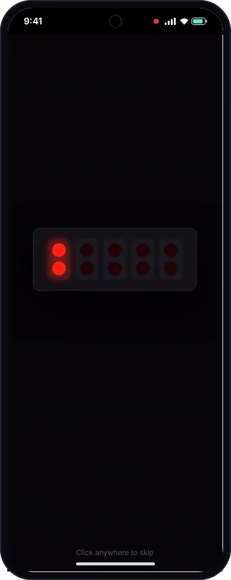</picture></a><a href="https://hemashreevi.github.io">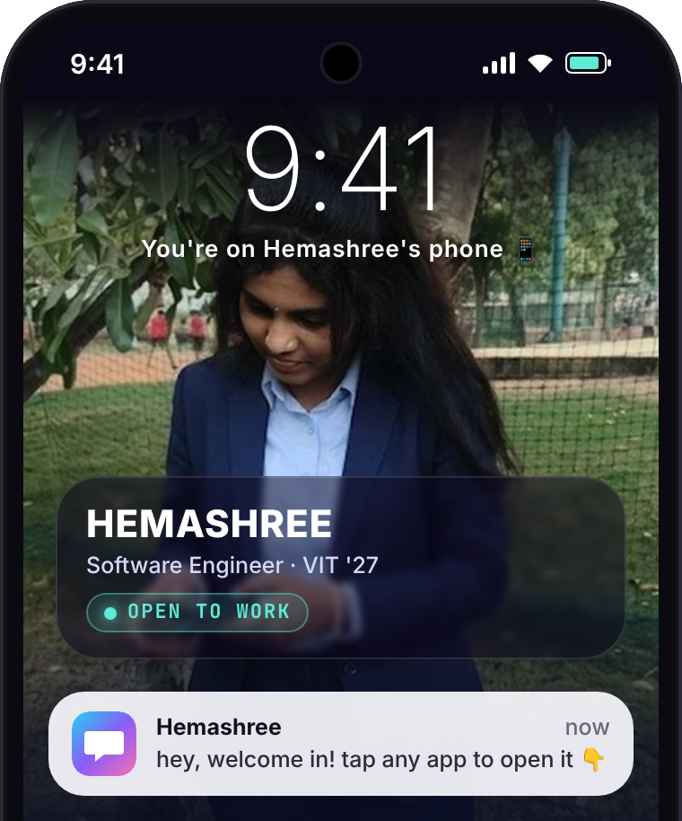</a> 
<a href="https://github.com/HemashreeVI/TriageIQ" title="TriageIQ: on-device AI inbox">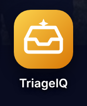</a> 
<a href="https://github.com/HemashreeVI/disaster-response-rover-nodered" title="Hazard-Detection Rover (patent)">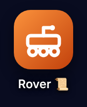</a><a href="https://github.com/HemashreeVI/AI_Malocclusion_Detection" title="Dental X-ray AI">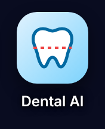</a><a href="https://www.youtube.com/@shreejith-l7o" title="Byte Decoded on YouTube">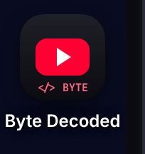</a> 
 
 
<a href="https://github.com/HemashreeVI?tab=repositories" title="All my repositories">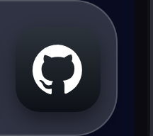</a> 

📱 tap any app on my phone

  
  
  
  
  

<a href="https://github.com/HemashreeVI/SeatLock" title="SeatLock on GitHub"></a>
<a href="https://github.com/HemashreeVI/rootlens" title="RootLens on GitHub"></a>

<a href="https://github.com/HemashreeVI/TriageIQ" title="TriageIQ on GitHub"></a>
<a href="https://hemashreevi.github.io/GitLoom/" title="Try GitLoom live"></a>

  
  

<a href="https://github.com/HemashreeVI/smart_walker" title="Smart Walker (patent) on GitHub"></a>
<a href="https://github.com/HemashreeVI/disaster-response-rover-nodered" title="Hazard-Detection Rover (patent) on GitHub"></a>

<a href="https://github.com/firstcontributions/first-contributions/pull/126858"></a>

  
  
  
  
  
  
  
  
  

<a href="https://github.com/HemashreeVI/job-radar" title="Job Radar on GitHub"></a>
<a href="https://github.com/HemashreeVI/repo-recap" title="Repo Recap on GitHub"></a>

<a href="https://github.com/HemashreeVI/byte-decoded-clipper" title="Byte Decoded Clipper on GitHub"></a>
<a href="https://github.com/HemashreeVI/contributions-decoded" title="Contributions Decoded on GitHub"></a>

<a href="https://www.youtube.com/@shreejith-l7o"></a>

<a href="https://hemashreevi.github.io"></a>

  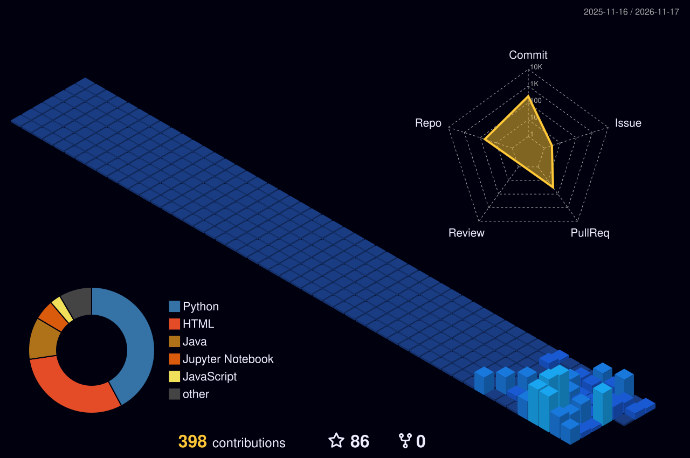

  
   
  

  

<b>🤫 Things you won't find on my résumé</b>

 

- 🏎️ I'm an **F1 fan**, which is why I'm building a race-replay app on real GPS data.
- 🎨 I design posters and creatives as Design Lead, so I care how things *look*, not just how they work.
- 🗾 I can say よろしくお願いします, and mean it.
- 🛠️ I'm building PortPilot because a Kafka container once stole my port 9092.

  
  
  
  
  

<a href="https://hemashreevi.github.io"></a>
