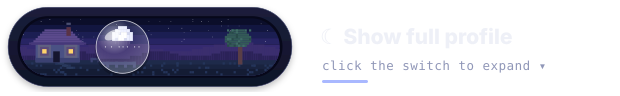
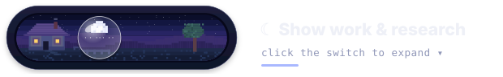
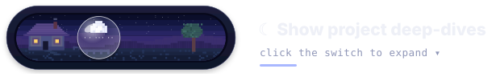

  
  
  

  &nbsp;&nbsp;
  &nbsp;&nbsp;
  &nbsp;&nbsp;
  &nbsp;&nbsp;
  &nbsp;&nbsp;
  &nbsp;&nbsp;
  

<picture><source media="(prefers-color-scheme: light)" srcset="./assets/cards/toggles/about-off-light.svg"></picture>

<picture><source media="(prefers-color-scheme: light)" srcset="./assets/cards/toggles/about-on-light.svg"></picture>

### 👋 Hi, I'm Hemashree

I'm a **B.Tech Computer Science Engineering** student at **VIT Chennai** (2023 → now) who builds systems that **see, decide and keep people safe**: concurrency-safe backends, self-healing microservices, on-device AI, computer vision and IoT.

**🎯 Open to:** software engineering roles in **backend & DevOps**, **computer vision**, **cybersecurity** and **cyber-physical systems**.

**🔭 Focus areas:** vision · reinforcement learning · embedded · security

| Area | Tools |
|---|---|
| **Languages** | Python · Java · C++ · JavaScript · SQL |
| **Backend & DevOps** | Spring Boot · FastAPI · Flask · Docker · Kafka · Redis · Prometheus · Grafana · GitHub Actions · k6 |
| **AI & vision** | PyTorch · TensorFlow · OpenCV · YOLOv8/v9 · Grad-CAM · MMPose · Q-learning · RAG · Ollama · watsonx |
| **Data** | PostgreSQL · SQLite · MySQL · Redis · Qdrant · Firebase |
| **Embedded & IoT** | Arduino · ESP32 · Raspberry Pi · sensor fusion · LIDAR SLAM |
| **Security** | threat modeling · intrusion detection · risk scoring |
| **Frontend & design** | HTML · CSS · JavaScript · Three.js · SVG animation · Canva |

**🗣️ Spoken:** Tamil · English · Hindi · 日本語 (studied Japanese as a subject at VIT Chennai)

**✨ Beyond code:** Team Leader of the CodeYGen Club · Design Lead of the Fitness Club · I run the **[Byte Decoded](https://www.youtube.com/@shreejith-l7o)** YouTube channel · F1 fan · chess player

<picture><source media="(prefers-color-scheme: light)" srcset="./assets/cards/toggles/work-off-light.svg"></picture>

<picture><source media="(prefers-color-scheme: light)" srcset="./assets/cards/toggles/work-on-light.svg"></picture>

#### 🔬 Research Intern · VIT Chennai · May – Jul 2025
Human pose estimation with **MMPose**, validated against **Kinovea** ground truth. → [heatmap-pose-estimation-kinovea](https://github.com/HemashreeVI/heatmap-pose-estimation-kinovea)

#### 🦷 Dental X-ray AI (research) · Jul – Sep 2025
Reads panoramic dental X-rays and explains what it sees: a **YOLOv9** pipeline detecting **31 dental conditions**, trained on **13,000+** X-rays (test mAP@50 **38.7%**), with per-finding **HiResCAM** heatmaps, an FDI tooth chart, a Gradio app and PDF reports. → [AI_Malocclusion_Detection](https://github.com/HemashreeVI/AI_Malocclusion_Detection)

#### 🧾 Patents · co-inventor · filing in progress
- **Smart Walker:** IoT-enabled walker with sensor-fusion fall-risk prediction and adaptive mobility assistance (dual IMUs + load cells, standalone on Arduino). Inventive disclosure filed with IIPRD. → [smart_walker](https://github.com/HemashreeVI/smart_walker)
- **Hazard-Detection Rover:** autonomous disaster-zone exploration with Q-learning navigation, CNN hazard perception, multi-hazard detection and a live rescue dashboard. → [disaster-response-rover-nodered](https://github.com/HemashreeVI/disaster-response-rover-nodered)

#### 🌐 Open source
Merged pull request to [firstcontributions/first-contributions](https://github.com/firstcontributions/first-contributions/pull/126858) (Oct 2026) · 14 MIT-licensed tools of my own

#### 🧑‍🤝‍🧑 Leadership
Team Leader, **CodeYGen Club** · Design Lead, **Fitness Club**

  
  

<picture><source media="(prefers-color-scheme: light)" srcset="./assets/cards/toggles/projects-off-light.svg"></picture>

<picture><source media="(prefers-color-scheme: light)" srcset="./assets/cards/toggles/projects-on-light.svg"></picture>

#### 🎟️ [SeatLock](https://github.com/HemashreeVI/SeatLock): thousands of buyers, one seat, zero double-bookings
- **Built:** 3 locking strategies (pessimistic, optimistic, Redis) · `@Version` fencing · partial unique index · Kafka saga + outbox · Redis waiting room
- **Proof:** exactly **1 of 200** racing threads wins a seat · **0 double-bookings** under k6 load · **2,171 req/s** with fast reject
- **Stack:** Java 21 · Spring Boot · PostgreSQL · Redis · Kafka · k6 · Testcontainers

#### 🔍 [RootLens](https://github.com/HemashreeVI/rootlens): finds out why a microservice broke, then fixes it within strict limits
- **Built:** detect → investigate → decide → act → verify · rolls back bad releases · audit log of every decision
- **Proof:** **< 2 min** from a real incident to resolved · **118** unit tests
- **Stack:** Python · FastAPI · Docker · Prometheus · Grafana · OpenTelemetry · SQLite · CI

#### 📨 [TriageIQ](https://github.com/HemashreeVI/TriageIQ): sorts every support email and drafts a grounded reply, fully on-device
- **Built:** Kafka pipeline · local LLM classifies with a safe fallback · RAG over solved tickets · a human approves every reply
- **Proof:** **3B** local model, data never leaves the machine · top-3 similar past tickets as context · **0** emails sent without approval
- **Stack:** Python · Kafka · Ollama · Qdrant · FastAPI · Docker · SSE

#### 🧵 [GitLoom](https://hemashreevi.github.io/GitLoom/): your GitHub, woven into a portfolio website
- **Built:** reads repos, languages and activity in the browser · live design studio · exports one `index.html` you can host free
- **Proof:** **10** templates from the same data · **1** HTML file · **0** servers or sign-ups
- **Stack:** JavaScript · HTML · CSS · GitHub REST API · GitHub Pages

  

  

  

  

  

  

  
  

<b>🤫 Things you won't find on my résumé</b>

 

- 🏎️ I'm an **F1 fan**, which is why I'm building a race-replay app on real GPS data.
- 🎨 I design posters and creatives as Design Lead, so I care how things *look*, not just how they work.
- 🗾 I can say よろしくお願いします, and mean it.
- 🛠️ I'm building PortPilot because a Kafka container once stole my port 9092.

  &nbsp;&nbsp;
  &nbsp;&nbsp;
  &nbsp;&nbsp;
  &nbsp;&nbsp;
  &nbsp;&nbsp;
  &nbsp;&nbsp;
  

