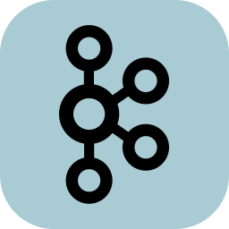
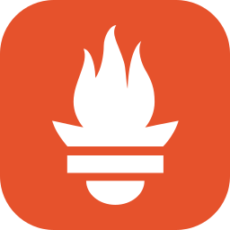
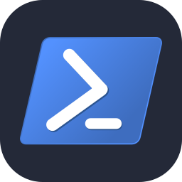

  
  
  

  
  
  

  
  
  
  

  
   ▶ Click the preview to watch the 1-minute demo

  
  
  

  
  
  
  
  

  <b>💻 Languages</b> 
  
  
  
  
  

  <b>🎨 Frontend</b> 
  
  
  
  
  

  <b>⚙️ Backend &amp; DevOps</b> 
  
  
  
  
  
  
  
  
  

  <b>✨ Motion &amp; Design</b> 
  
  
  
  

  <b>🧠 AI &amp; Vision</b> 
  
  
  
  
  
  

  <b>🗄️ Data</b> 
  
  
  
  
  

  <b>🔌 Embedded &amp; IoT</b> 
  
  
  

  <b>🛠️ Tools</b> 
  
  
  
  
  
  
  
  
  
  

Want to drag real pieces? Play the <a href="https://hemashreevi.github.io/chess/"><b>full chess board on my portfolio</b></a>. Or play right here on GitHub: you're White, a Stockfish bot plays Black.

<!-- CHESS:START -->

  

<b>How to play:</b> the board above is a picture, so pieces can't be dragged here (they can on <a href="https://hemashreevi.github.io/chess/">my portfolio</a>). Pick your move from this list instead: click it, press <b>Create</b> on the page GitHub opens, and come back in about a minute to see your move and the bot's reply.

| Piece | From | Moves |
| :-- | :-: | :-- |
| ♙ Pawn | `a2` | [a3](https://github.com/HemashreeVI/HemashreeVI/issues/new?title=chess%7Cmove%7Ca2a3&body=Press%20%2A%2ACreate%2A%2A%20to%20play%20this%20move.%20The%20bot%20replies%20and%20the%20board%20updates%20in%20about%20a%20minute.) · [a4](https://github.com/HemashreeVI/HemashreeVI/issues/new?title=chess%7Cmove%7Ca2a4&body=Press%20%2A%2ACreate%2A%2A%20to%20play%20this%20move.%20The%20bot%20replies%20and%20the%20board%20updates%20in%20about%20a%20minute.) |
| ♙ Pawn | `b2` | [b3](https://github.com/HemashreeVI/HemashreeVI/issues/new?title=chess%7Cmove%7Cb2b3&body=Press%20%2A%2ACreate%2A%2A%20to%20play%20this%20move.%20The%20bot%20replies%20and%20the%20board%20updates%20in%20about%20a%20minute.) · [b4](https://github.com/HemashreeVI/HemashreeVI/issues/new?title=chess%7Cmove%7Cb2b4&body=Press%20%2A%2ACreate%2A%2A%20to%20play%20this%20move.%20The%20bot%20replies%20and%20the%20board%20updates%20in%20about%20a%20minute.) |
| ♙ Pawn | `c2` | [c3](https://github.com/HemashreeVI/HemashreeVI/issues/new?title=chess%7Cmove%7Cc2c3&body=Press%20%2A%2ACreate%2A%2A%20to%20play%20this%20move.%20The%20bot%20replies%20and%20the%20board%20updates%20in%20about%20a%20minute.) · [c4](https://github.com/HemashreeVI/HemashreeVI/issues/new?title=chess%7Cmove%7Cc2c4&body=Press%20%2A%2ACreate%2A%2A%20to%20play%20this%20move.%20The%20bot%20replies%20and%20the%20board%20updates%20in%20about%20a%20minute.) |
| ♙ Pawn | `d2` | [d3](https://github.com/HemashreeVI/HemashreeVI/issues/new?title=chess%7Cmove%7Cd2d3&body=Press%20%2A%2ACreate%2A%2A%20to%20play%20this%20move.%20The%20bot%20replies%20and%20the%20board%20updates%20in%20about%20a%20minute.) · [d4](https://github.com/HemashreeVI/HemashreeVI/issues/new?title=chess%7Cmove%7Cd2d4&body=Press%20%2A%2ACreate%2A%2A%20to%20play%20this%20move.%20The%20bot%20replies%20and%20the%20board%20updates%20in%20about%20a%20minute.) |
| ♙ Pawn | `e2` | [e3](https://github.com/HemashreeVI/HemashreeVI/issues/new?title=chess%7Cmove%7Ce2e3&body=Press%20%2A%2ACreate%2A%2A%20to%20play%20this%20move.%20The%20bot%20replies%20and%20the%20board%20updates%20in%20about%20a%20minute.) · [e4](https://github.com/HemashreeVI/HemashreeVI/issues/new?title=chess%7Cmove%7Ce2e4&body=Press%20%2A%2ACreate%2A%2A%20to%20play%20this%20move.%20The%20bot%20replies%20and%20the%20board%20updates%20in%20about%20a%20minute.) |
| ♙ Pawn | `f2` | [f3](https://github.com/HemashreeVI/HemashreeVI/issues/new?title=chess%7Cmove%7Cf2f3&body=Press%20%2A%2ACreate%2A%2A%20to%20play%20this%20move.%20The%20bot%20replies%20and%20the%20board%20updates%20in%20about%20a%20minute.) · [f4](https://github.com/HemashreeVI/HemashreeVI/issues/new?title=chess%7Cmove%7Cf2f4&body=Press%20%2A%2ACreate%2A%2A%20to%20play%20this%20move.%20The%20bot%20replies%20and%20the%20board%20updates%20in%20about%20a%20minute.) |
| ♙ Pawn | `g2` | [g3](https://github.com/HemashreeVI/HemashreeVI/issues/new?title=chess%7Cmove%7Cg2g3&body=Press%20%2A%2ACreate%2A%2A%20to%20play%20this%20move.%20The%20bot%20replies%20and%20the%20board%20updates%20in%20about%20a%20minute.) · [g4](https://github.com/HemashreeVI/HemashreeVI/issues/new?title=chess%7Cmove%7Cg2g4&body=Press%20%2A%2ACreate%2A%2A%20to%20play%20this%20move.%20The%20bot%20replies%20and%20the%20board%20updates%20in%20about%20a%20minute.) |
| ♙ Pawn | `h2` | [h3](https://github.com/HemashreeVI/HemashreeVI/issues/new?title=chess%7Cmove%7Ch2h3&body=Press%20%2A%2ACreate%2A%2A%20to%20play%20this%20move.%20The%20bot%20replies%20and%20the%20board%20updates%20in%20about%20a%20minute.) · [h4](https://github.com/HemashreeVI/HemashreeVI/issues/new?title=chess%7Cmove%7Ch2h4&body=Press%20%2A%2ACreate%2A%2A%20to%20play%20this%20move.%20The%20bot%20replies%20and%20the%20board%20updates%20in%20about%20a%20minute.) |
| ♘ Knight | `b1` | [Na3](https://github.com/HemashreeVI/HemashreeVI/issues/new?title=chess%7Cmove%7Cb1a3&body=Press%20%2A%2ACreate%2A%2A%20to%20play%20this%20move.%20The%20bot%20replies%20and%20the%20board%20updates%20in%20about%20a%20minute.) · [Nc3](https://github.com/HemashreeVI/HemashreeVI/issues/new?title=chess%7Cmove%7Cb1c3&body=Press%20%2A%2ACreate%2A%2A%20to%20play%20this%20move.%20The%20bot%20replies%20and%20the%20board%20updates%20in%20about%20a%20minute.) |
| ♘ Knight | `g1` | [Nf3](https://github.com/HemashreeVI/HemashreeVI/issues/new?title=chess%7Cmove%7Cg1f3&body=Press%20%2A%2ACreate%2A%2A%20to%20play%20this%20move.%20The%20bot%20replies%20and%20the%20board%20updates%20in%20about%20a%20minute.) · [Nh3](https://github.com/HemashreeVI/HemashreeVI/issues/new?title=chess%7Cmove%7Cg1h3&body=Press%20%2A%2ACreate%2A%2A%20to%20play%20this%20move.%20The%20bot%20replies%20and%20the%20board%20updates%20in%20about%20a%20minute.) |

<!-- CHESS:END -->

  

  
   
  🐟 My <a href="https://github.com/HemashreeVI/git-koi">git koi</a>, redrawn every night from the day's activity

  

  
  

  

  

<b>🤫 Things you won't find on my résumé</b>

 

- 🏎️ I'm an **F1 fan**, which is why I'm building a race-replay app on real GPS data.
- 🎨 I design posters and creatives as Design Lead, so I care how things *look*, not just how they work.
- 🗾 I can say よろしくお願いします, and mean it.
- 🛠️ I'm building PortPilot because a Kafka container once stole my port 9092.

  
  
  

