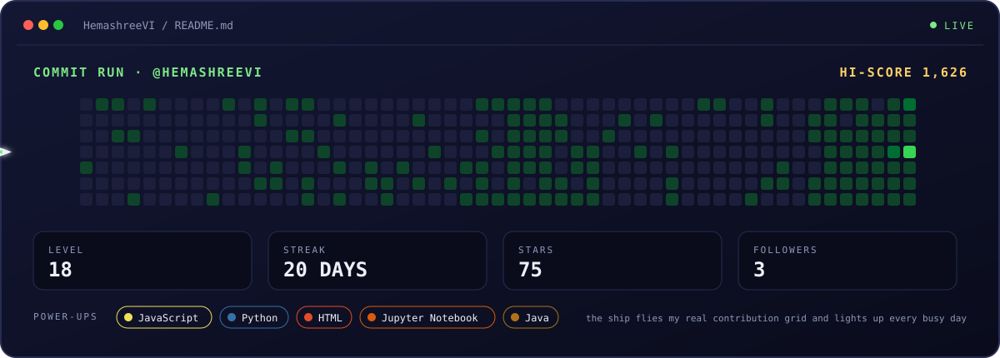

  
  
  

  &nbsp;&nbsp;
  &nbsp;&nbsp;
  &nbsp;&nbsp;
  &nbsp;&nbsp;
  &nbsp;&nbsp;
  &nbsp;&nbsp;
  

  
  

  

  
   
  
  

  

  

  

  

  
  

<b>🤫 Things you won't find on my résumé</b>

 

- 🏎️ I'm an **F1 fan**, which is why I'm building a race-replay app on real GPS data.
- 🎨 I design posters and creatives as Design Lead, so I care how things *look*, not just how they work.
- 🗾 I can say よろしくお願いします, and mean it.
- 🛠️ I'm building PortPilot because a Kafka container once stole my port 9092.

  &nbsp;&nbsp;
  &nbsp;&nbsp;
  &nbsp;&nbsp;
  &nbsp;&nbsp;
  &nbsp;&nbsp;
  &nbsp;&nbsp;
  

