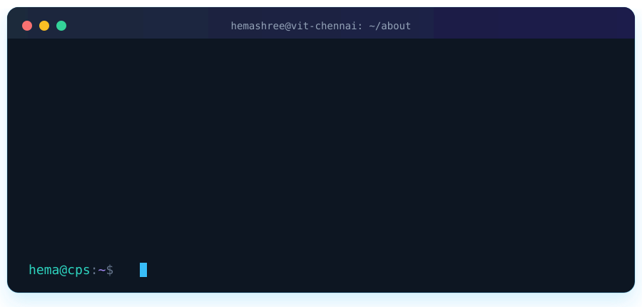
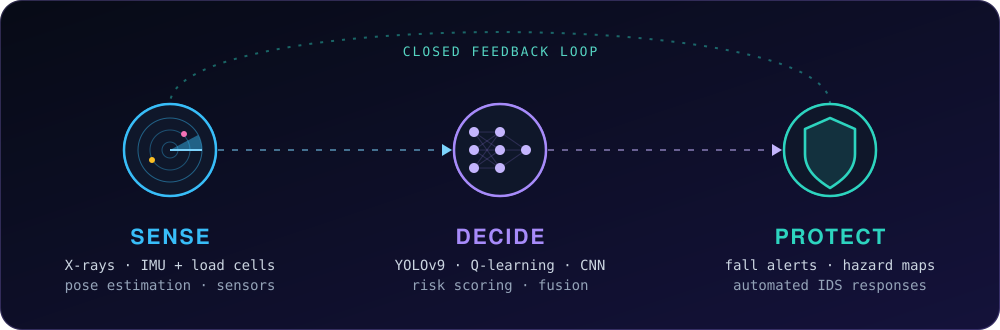

 

---

## 🖥️ `./about.sh`

---

## 🧠 How I think about problems

Every project I build follows the same loop: perceive the world, decide, and make someone safer.

---

## 🚀 Featured projects

<table>
<tr>
<td width="50%" valign="top">

### 🦷 Dental Malocclusion Detection
YOLOv9 pipeline that detects **31 dental conditions** and analyses teeth alignment from X-rays. **~97% accuracy** on a **13,000+** image dataset, with Grad-CAM explanations, FDI tooth mapping, a Gradio app and PDF reports.

`YOLOv9` `Grad-CAM` `Gradio` `OpenCV`

[**→ View repo**](https://github.com/HemashreeVI/AI_Malocclusion_Detection)

</td>
<td width="50%" valign="top">

### 🤖 RL Rover for Hazard Detection
A simulated rover that learns to explore a disaster area and *discovers* hazards through perception. Tabular Q-learning plus a lightweight CNN, with a 4-way reward ablation.

`Q-Learning` `CNN` `Python`

[**→ View repo**](https://github.com/HemashreeVI/Rover)

</td>
</tr>
<tr>
<td width="50%" valign="top">

### 🥬 Smart Grocer
Multimodal system for **fresh-produce spoilage detection**, item localization and **expiry-aware retail inventory management**.

`Python` `Computer Vision` `Inventory`

[**→ View repo**](https://github.com/HemashreeVI/smart-grocer)

</td>
<td width="50%" valign="top">

### 🦯 Smart Walker (patent)
Co-invented IoT walker that *predicts* fall risk using dual IMUs and load cells with sensor fusion. Runs standalone on Arduino for under USD 30. **Filing in progress.**

`Arduino` `MPU6050` `HX711`

</td>
</tr>
<tr>
<td width="50%" valign="top">

### 🛡️ Intrusion Detection & Threat Modeling
Behavioral IDS for a simulated banking platform: risk scoring across login, access and transaction events, automated responses and audit logging.

`Python` `IDS` `Threat Modeling`

</td>
<td width="50%" valign="top">

### 🎙️ Jarvis, a local voice assistant
Offline-first, privacy-friendly voice assistant: opens apps, system controls, battery/status and stock notifications.

`Python` `SpeechRecognition`

[**→ View repo**](https://github.com/HemashreeVI/JarvisAI)

</td>
</tr>
</table>

---

## 🧰 Tech & tools

  

---

## 🏅 Milestones

| | |
|---|---|
| 📜 **Patent** *(filing in progress)* | IoT-Enabled Smart Walker with Sensor-Fusion Fall Risk Prediction and Adaptive Mobility Assistance. Co-inventor; inventive disclosure filed with IIPRD |
| 🔬 **Research Intern, VIT Chennai** | Human pose estimation with MMPose, validated against Kinovea ground truth (May–Jul 2025) |
| 🌏 **NUS** | Introduction to Industry 4.0 Programme, National University of Singapore (Jun 2025) |
| 🤖 **SuperAI 2025** | Marina Bay Sands, Singapore |
| 🧠 **IBM** | Generative AI certification, *Gen AI Using IBM watsonx* |
| 🎨 **Leadership** | Team Leader, CodeYGen Club · Design Lead, Fitness Club |

🎓 **VIT Chennai**: B.Tech CSE, Cyber-Physical Systems · CGPA 7.81 · Aug 2023 – present

---

## 🧊 My contributions, in 3D

 

  

---

### 💬 Let's build something that keeps people safe.
Open to roles in **cybersecurity · computer vision · cyber-physical systems**

