

  
  
  

<a href="https://hemashreevi.github.io">
  
</a>

  &nbsp;&nbsp;
  &nbsp;&nbsp;
  &nbsp;&nbsp;
  &nbsp;&nbsp;
  &nbsp;&nbsp;
  &nbsp;&nbsp;
  

<a href="https://hemashreevi.github.io" title="Open my portfolio"><picture><source media="(min-width: 1200px)" srcset="https://raw.githubusercontent.com/HemashreeVI/HemashreeVI/main/assets/phone/playing-wide-2e2298bb.webp">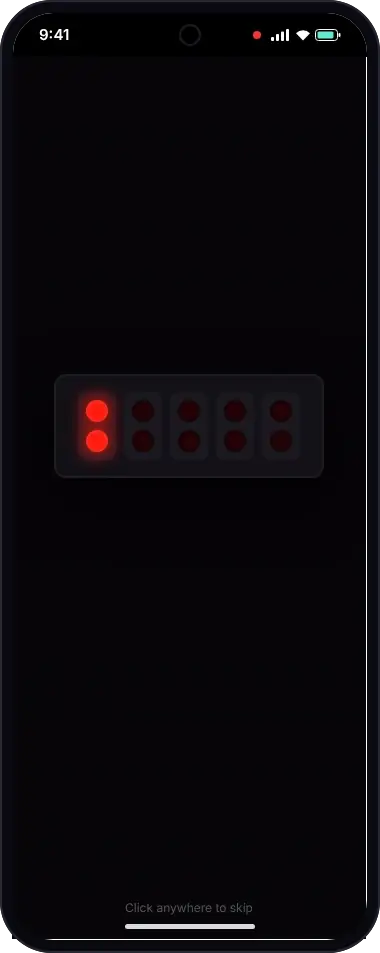</picture></a><a href="https://hemashreevi.github.io">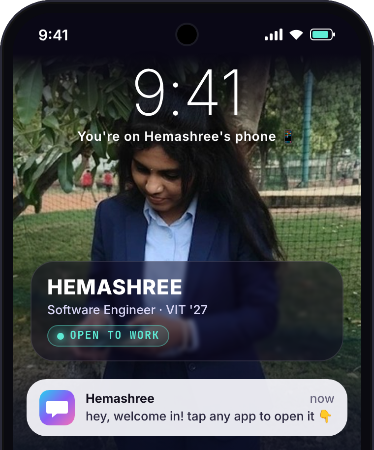</a> 
<a href="https://github.com/HemashreeVI/SeatLock" title="SeatLock: zero double-bookings">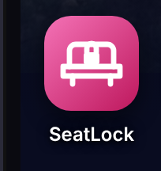</a><a href="https://github.com/HemashreeVI/rootlens" title="RootLens: incident response">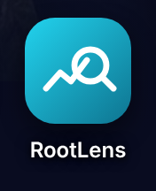</a><a href="https://github.com/HemashreeVI/TriageIQ" title="TriageIQ: on-device AI inbox">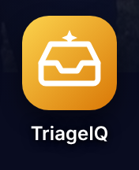</a><a href="https://hemashreevi.github.io/GitLoom/" title="GitLoom: GitHub to portfolio">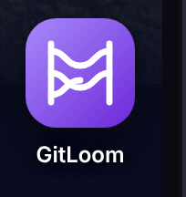</a> 
<a href="https://github.com/HemashreeVI/smart_walker" title="Smart Walker (patent)">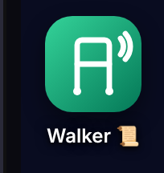</a><a href="https://github.com/HemashreeVI/disaster-response-rover-nodered" title="Hazard-Detection Rover (patent)">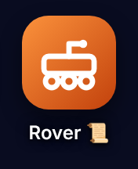</a><a href="https://github.com/HemashreeVI/AI_Malocclusion_Detection" title="Dental X-ray AI">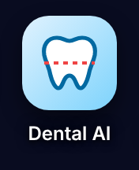</a><a href="https://www.youtube.com/@shreejith-l7o" title="Byte Decoded on YouTube">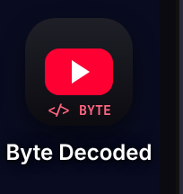</a> 
<a href="https://leetcode.com/u/hemashree_272005/" title="LeetCode">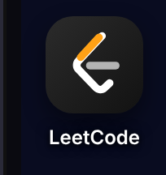</a><a href="https://www.chess.com/member/hemashreevi" title="Play me on Chess.com">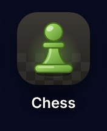</a><a href="https://hemashreevi.github.io" title="My portfolio">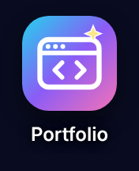</a><a href="https://hemashreevi.github.io" title="Mini-games on my portfolio">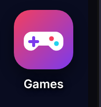</a> 
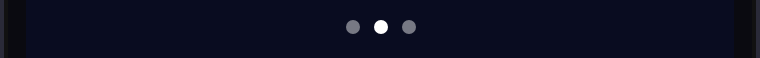 
<a href="https://www.instagram.com/hemashree_2_7/" title="Instagram">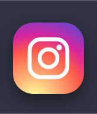</a><a href="https://github.com/HemashreeVI?tab=repositories" title="All my repositories">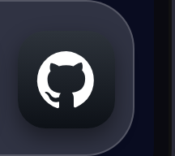</a> 

📱 tap any app on my phone

  
  
  
  
  





<a href="https://github.com/HemashreeVI/SeatLock"></a>

<a href="https://github.com/HemashreeVI/rootlens"></a>

<a href="https://github.com/HemashreeVI/TriageIQ"></a>

✨ <b>Also built</b> ✨

<a href="https://hemashreevi.github.io/GitLoom/"></a>

  <a href="https://hemashreevi.github.io/assets/video/gitloom-demo.mp4">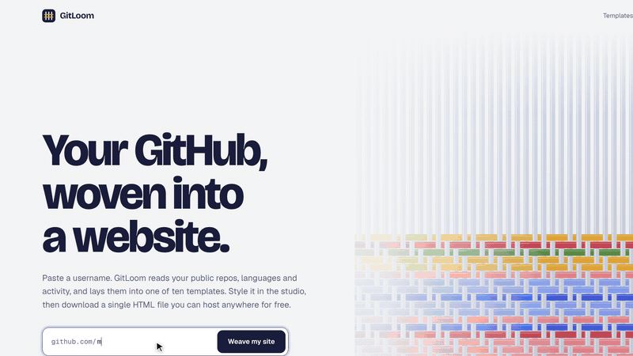</a>
   ▶ Click the preview to watch the 1-minute demo

  
  
  

<a href="https://github.com/HemashreeVI/AI_Malocclusion_Detection"></a>


<a href="https://github.com/HemashreeVI/smart_walker"></a>

<a href="https://github.com/HemashreeVI/disaster-response-rover-nodered"></a>

<a href="https://github.com/firstcontributions/first-contributions/pull/126858"></a>

  
  
  
  
  
  
  
  
  


  <b>💻 Languages</b> 
  
  
  
  
  

  <b>🎨 Frontend</b> 
  
  
  
  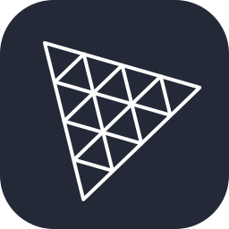
  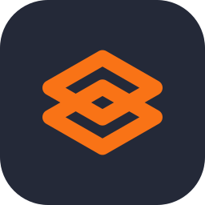

  <b>⚙️ Backend &amp; DevOps</b> 
  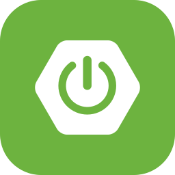
  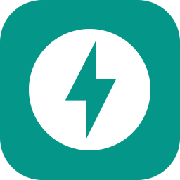
  
  
  
  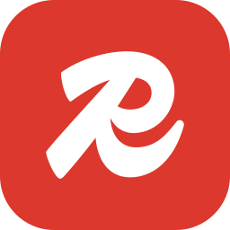
  
  
  

  <b>✨ Motion &amp; Design</b> 
  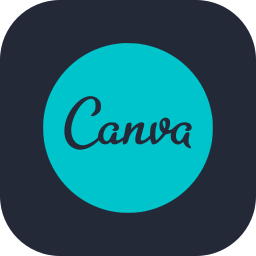
  
  
  

  <b>🧠 AI &amp; Vision</b> 
  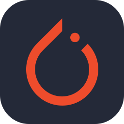
  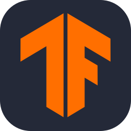
  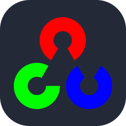
  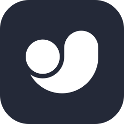
  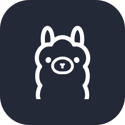
  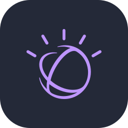

  <b>🗄️ Data</b> 
  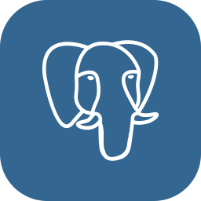
  
  
  
  

  <b>🔌 Embedded &amp; IoT</b> 
  
  
  

  <b>🛠️ Tools</b> 
  
  
  
  
  
  
  
  
  
  

Want to drag real pieces? Play the <a href="https://hemashreevi.github.io/chess/"><b>full chess board on my portfolio</b></a>. Or play right here on GitHub: you're White, a Stockfish bot plays Black.

  

  
   
  

  

  
  

  

  

<b>🤫 Things you won't find on my résumé</b>

 

- 🏎️ I'm an **F1 fan**, which is why I'm building a race-replay app on real GPS data.
- 🎨 I design posters and creatives as Design Lead, so I care how things *look*, not just how they work.
- 🗾 I can say よろしくお願いします, and mean it.
- 🛠️ I'm building PortPilot because a Kafka container once stole my port 9092.

  &nbsp;&nbsp;
  &nbsp;&nbsp;
  &nbsp;&nbsp;
  &nbsp;&nbsp;
  &nbsp;&nbsp;
  &nbsp;&nbsp;
  

  
  
  
  
  

